#  caso 1 Titanic 
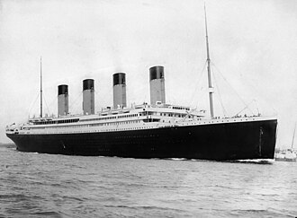

# mapa titanic ( Resultados )
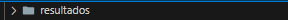
# 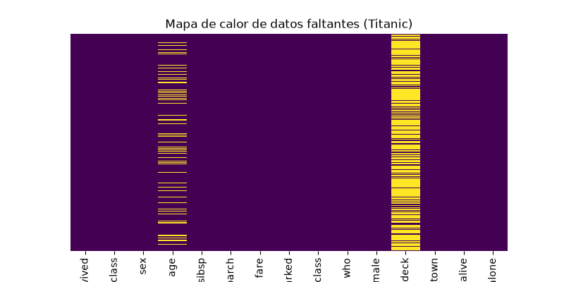

# ===== 1. VISTA PREVIA DE DATOS =====
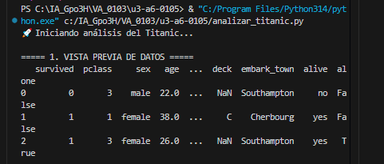

# ===== 2. DIMENSIONES =====   
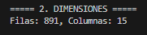

# ===== 3. TIPOS DE DATOS =====
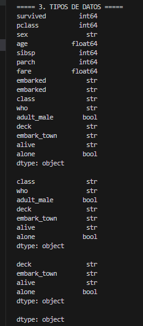

# ===== 4. DATOS NULOS (Cantidad) =====
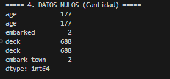

# porcentage de nulos 1 
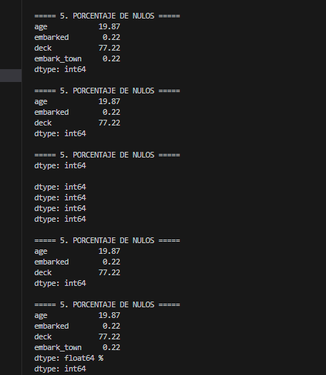
# porcentage de nulos parte 2 
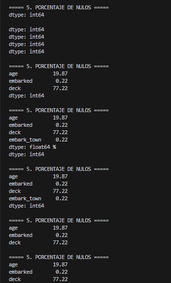
# porcentage de nulos parte 3 
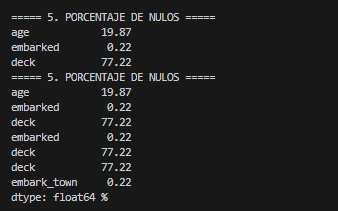

# registros duplicados y valores atopicos 
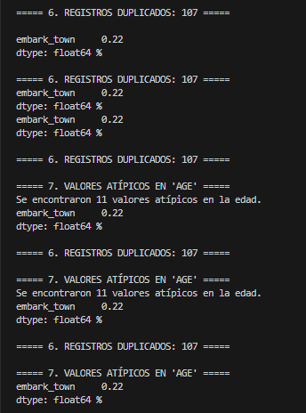
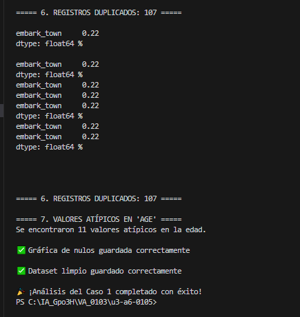
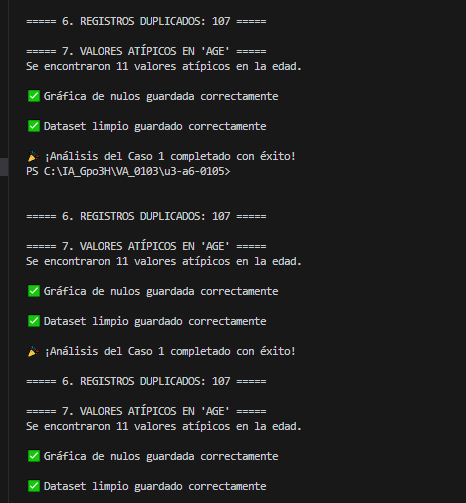